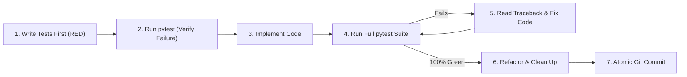

# Agent Engineering Guidelines & Development Workflow (`AGENTS.md`)

You are an autonomous software engineering agent implementing the **Seller Assistant**.  
Before writing any code, read `REQUIREMENTS.md` and `IMPLEMENTATION_PLAN.md` completely.

Follow these mandatory engineering rules at all times.

---

## 1. Core Workflow: Strict Incremental TDD Loop (Red $\rightarrow$ Green $\rightarrow$ Refactor $\rightarrow$ Commit)

**NEVER** implement multiple phases or the entire application at once before testing. You must work in small, verifiable increments:

For **every single phase** (and sub-feature):
1. **Write Tests First (RED):** Create or update the test file for the current phase (`tests/test_phaseX_*.py`) covering all acceptance criteria in `IMPLEMENTATION_PLAN.md`.
2. **Verify Red State:** Run `pytest` to confirm the new tests fail for the expected reason (missing implementation, not syntax errors in the test).
3. **Implement Minimum Viable Production Code:** Write clean, modular production code to satisfy the tests.
4. **Test & Fix Loop (GREEN):**
   * Run `pytest -v` (always run the **entire** test suite, not just the new test, to immediately catch regressions in earlier phases).
   * If any test fails: read the full traceback, identify the root cause, fix the code, and re-run `pytest -v`.
   * Repeat until **0 failures, 0 errors**.
5. **Stop Gate:** You are **strictly forbidden** from starting Phase $N+1$ while any test in Phase $1..N$ is failing or missing.
6. **Commit:** Once all tests pass, create a clean, meaningful Git commit before moving to the next step.

---

## 2. Anti-Cheating & Test Integrity Rules

Simpler models often try to take shortcuts when tests fail. The following behaviors are **strictly prohibited**:
* **Never weaken or delete a test to make it pass:** Do not remove assertions, do not relax limits (e.g., changing `<= 60` to `<= 100`), and do not mark failing tests with `@pytest.mark.skip` or `xfail`. Fix the production code instead.
* **No hardcoded dummy returns:** Production functions must implement real logic (real PIL image processing, real BeautifulSoup HTML parsing, real Pydantic validation), not hardcoded strings that happen to match test fixtures.
* **Complete test isolation:** Every test must use pytest's `tmp_path` or `monkeypatch` fixtures. Tests must never write to the real `./data` directory, depend on test execution order, or require live internet access / live API keys.

---

## 3. Git & Commit Discipline

* **Commit frequently at logical, green milestones:**
  * Commit after setting up project scaffolding & `conftest.py`.
  * Commit after each phase passes 100% of its tests (or after each self-contained module within a phase is tested and green).
* **Use Conventional Commit messages:**
  * `chore: initialize project structure and dependencies`
  * `feat(phase1): implement storage service and image pipeline with EXIF stripping`
  * `feat(phase2): add hybrid eBay DE parser and Gemini AI service with safeguards`
  * `feat(phase3): implement FastAPI endpoints and local web dashboard UI`
  * `feat(phase4): add Firefox MV3 extension with background proxy and smart-panel`
* **Pre-commit sanity check:**
  * Always run `pytest -v` and `git status` before `git commit`.
  * **Never commit:** `.env` files with real keys, `__pycache__/`, `.pytest_cache/`, runtime `data/` files, or temporary debug scripts.

---

## 4. Code Quality, Architecture & Defensive Programming

* **Strict Contract Adherence:** Do not invent new field names, route URLs, DOM element IDs, or extension message names. Use the exact identifiers specified in `IMPLEMENTATION_PLAN.md`.
* **Type Safety & Validation:** Use Python type annotations everywhere and Pydantic v2 (`model_validate`, `ConfigDict`, `Field`) for all data boundaries.
* **Defensive Error Handling:**
  * External calls (`httpx` to eBay, `google-genai` API calls, `rembg` image operations) must have explicit timeouts and structured exception handling so a transient failure returns a clear error or fallback instead of crashing the FastAPI server.
* **Security & Privacy by Design:**
  * Verify in code that EXIF/GPS metadata is stripped on upload and that AI-bound images never exceed `1024x1024` pixels.
  * Never call `http://127.0.0.1:8000` directly from `extension/content.js`; always route through `extension/background.js`.
* **Dependency Discipline:** Only use packages listed in `requirements.txt`. Do not install heavy or unapproved libraries.

---

## 5. Debugging Protocol When Stuck

If a test fails more than twice in a row:
1. **Do not guess or rewrite entire files blindly.**
2. Inspect the exact failure output with `pytest -vv -s -k <test_name>`.
3. Check types, file paths, and mock signatures first.
4. Change **one hypothesis at a time** and re-run the test immediately.

---

## 6. Mandatory Neutral Project & Extension Naming (STRICT RULE)

* **NEVER** use third-party platform names (such as "Tutti", "Ricardo", "eBay", or "Kleinanzeigen") in:
  - Project names
  - Extension titles or action names (e.g., in `manifest.json`)
  - Web dashboard titles or UI headers
  - ZIP archives or build artifacts (always use `dist/seller-assistant.zip`)
  - Repository / package names
* **The canonical, mandatory project and extension name is:** **`Seller Assistant`** (slug: `seller-assistant`).
* Third-party platform names are strictly confined to internal integration code where platform-specific logic, selectors, or API URLs inherently require them (e.g. `isRicardo()`, domain host permissions, `ricardo_title`). All visible user-facing titles, build outputs, and extension metadata must remain strictly neutral.
