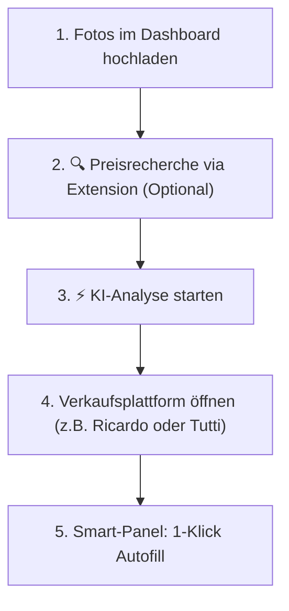

# 🤖 OccAIsion

> **OccAIsion** ist dein intelligenter, lokaler KI-Verkaufsassistent für Secondhand- und Kleinanzeigen-Plattformen in der **Schweiz** (Ricardo.ch, Tutti.ch) und **Deutschland** (eBay.de, Kleinanzeigen.de).

---

## 📖 Inhaltsverzeichnis
1. [Was macht die App?](#-was-macht-die-app)
2. [Google Gemini API Key erhalten](#-google-gemini-api-key-erhalten)
3. [Schnellstart: Installation & Inbetriebnahme](#-schnellstart-installation--inbetriebnahme)
   - [Schritt 1: Backend via Docker starten](#schritt-1-backend-via-docker-starten)
   - [Schritt 2: Firefox-Extension installieren](#schritt-2-firefox-extension-installieren)
4. [Benutzungsanleitung (Workflow)](#-benutzungsanleitung-workflow)
5. [Unterstützte Plattformen](#-unterst%C3%BCtzte-plattformen)
6. [Entwicklung & Build](#-entwicklung--build)
7. [Datenschutz & Sicherheit](#-datenschutz--sicherheit)

---

## 🎯 Was macht die App?

Das Einstellen gebrauchter Artikel auf Marktplätzen ist meist zeitaufwendig: Fotos müssen aufbereitet, Preise mühsam recherchiert, ansprechende Beschreibungen verfasst und Formulare auf mehreren Plattformen einzeln ausgefüllt werden.

**OccAIsion automatisiert diesen gesamten Prozess:**

* 📸 **Datenschutz- und Foto-Pipeline:**  
  * Bereinigt automatisch alle EXIF- und GPS-Metadaten deiner Bilder.
  * Wandelt iPhone HEIC-Fotos automatisch in Standard-JPEGs um.
  * Skaliert Bilder für die KI-Verarbeitung intelligent herunter.
  * Optionale Hintergrundentfernung (Freistellen) oder weicher Hintergrundunschärfe-Filter (Bokeh).
* 🔍 **Anti-Bot-resistente Preisrecherche über 7 Plattformen:**  
  * Ermittelt über eine schlanke Browser-Extension echte Marktpreise aus deiner aktiven Browsersitzung:
    1. **eBay.de** (tatsächlich beendete & verkaufte Artikel privater Verkäufer)
    2. **Kleinanzeigen.de** (aktuelle private Gebrauchtangebote)
    3. **Idealo.de** (Neupreise in EUR)
    4. **Ricardo.ch** (aktuelle Gebrauchtangebote privater Schweizer Verkäufer)
    5. **Toppreise.ch** (Schweizer Neupreise in CHF)
    6. **Digitec / Galaxus.ch** (Schweizer Neupreise in CHF)
    7. **Tutti.ch** (aktuelle private Inserate in CHF)
  * Automatische Berechnung des 10%-getrimmten Medians zur Eliminierung von Ausreissern.
* ⚡ **Multimodale KI-Analyse mit Google Gemini:**  
  * Erkennt Produkt, Marke, Modell, Zustand und sichtbare Gebrauchsspuren aus den Fotos.
  * Weist auf fehlende Detailfotos hin (z. B. Typenschild, Anschlüsse, Zubehör).
  * Generiert massgeschneiderte, plattformoptimierte Titel und Texte.
  * Fügt automatisch rechtssichere Privatverkaufs-Haftungsausschlüsse für CH und DE ein.
* 🚀 **1-Klick-Inserate-Assistent (Firefox MV3 Smart-Panel):**  
  * Erkennt automatisch die Zielplattform (Ricardo, Tutti, eBay, Kleinanzeigen).
  * Füllt Formulare Schritt für Schritt per Klick aus:
    * **Tutti.ch:** Automatischer Kategorie-Drilldown im Menü, Übernahme von Titel, Beschreibung, Zustand, PLZ und Versandoption.
    * **Ricardo.ch:** Startpreis, automatisches Aktivieren des Sofortkauf-Toggles inkl. Preiseingabe, mehrstufige Versand-Konfiguration (Paket, Brief, Abholung).
    * **Bilder-Upload:** Injiziert die optimierten Bilder direkt per Drag-and-Drop / File-Transfer in die Dropzones der Plattformen.
    * **Fallback:** 1-Klick-Kopierbuttons für jedes Feld.

---

## 🔑 Google Gemini API Key erhalten

OccAIsion nutzt die multimodalen Modelle von **Google Gemini** (standardmäßig `gemini-2.5-flash`). Der API-Key ist über Google AI Studio **kostenlos** erhältlich.

### Schritt-für-Schritt:
1. Öffne die Website von **Google AI Studio**:  
   👉 [https://aistudio.google.com/](https://aistudio.google.com/)
2. Melde dich mit deinem normalen Google-Konto an.
3. Klicke links oben bzw. in der Navigation auf **"Get API key"** (oder **"API-Schlüssel abrufen"**).
4. Klicke auf den blauen Button **"Create API key"** (in neuem oder bestehendem Google Cloud-Projekt).
5. Kopiere den generierten API-Schlüssel (beginnt in der Regel mit `AIzaSy...`).

> [!TIP]
> **Kosten:** Der *Free Tier* von Google AI Studio bietet ein großzügiges monatliches Kontingent (mehrere Anfragen pro Minute), das für den privaten Gebrauch völlig ausreicht. Es fallen **keine Kosten** an.

---

## 📦 Schnellstart: Installation & Inbetriebnahme

### Option A: Fertige GitHub-Releases herunterladen (Empfohlen)

Unter **GitHub Releases** stehen zu jedem Release zwei vorgefertigte Download-Pakete bereit:
* **`occaision.zip`:** Die fertige Firefox-Erweiterung (direkt installierbar).
* **`occaision-docker.tar.gz`:** Das fertige Docker-Image zum direkten Laden ohne Build-Tools.

#### 1. Backend starten:
```bash
# Docker-Image aus Release-Archiv laden
docker load -i occaision-docker.tar.gz

# Verzeichnis für Entwürfe & .env vorbereiten
mkdir -p data
echo "GEMINI_API_KEY=AIzaSy...DeinSchluesselHier" > .env

# Container starten
docker run -d \
  --name occaision \
  -p 127.0.0.1:8000:8000 \
  -v "$(pwd)/data:/app/data" \
  --env-file .env \
  --restart unless-stopped \
  occaision:latest
```

*(Alternativ kann das Image auch direkt aus der GitHub Container Registry gezogen werden:*  
`docker pull ghcr.io/<owner>/occaision:latest`*)*

---

### Option B: Aus dem Git-Repository starten (Docker Compose)

1. **Repository klonen:**
   ```bash
   git clone <repo-url>
   cd seller
   ```

2. **Umgebungskonfiguration anlegen:**
   Kopiere die Vorlage `.env.example` nach `.env`:
   ```bash
   cp .env.example .env
   ```
   Trage in `.env` deinen `GEMINI_API_KEY` ein.

3. **Container mit Docker Compose starten:**
   ```bash
   docker compose up -d
   ```

4. **Web-Dashboard im Browser öffnen:**  
   👉 [http://localhost:8000](http://localhost:8000) (bzw. [http://127.0.0.1:8000](http://127.0.0.1:8000))

   *Falls du den API-Key nicht in der `.env`-Datei eingetragen hast, kannst du ihn im Dashboard jederzeit über den Button **⚙️ Einstellungen** hinterlegen.*

---

### Schritt 2: Firefox-Extension installieren

Die Extension stellt die Schnittstelle zwischen dem lokalen Dashboard und den Verkaufsplattformen dar. Sie ist im Repository bereits als fertiges Paket enthalten:

1. Öffne in Firefox einen neuen Tab und navigiere zu:
   ```
   about:debugging#/runtime/this-firefox
   ```
2. Klicke auf den Button **"Temporäres Add-on laden..."** (engl. *"Load Temporary Add-on..."*).
3. Wähle die bereitgestellte ZIP-Datei aus:
   ```
   dist/occaision.zip
   ```
   *(Alternativ für Entwickler: Wähle direkt die Datei `extension/manifest.json` aus).*
4. **Fertig!** Das OccAIsion-Icon erscheint in der Firefox-Symbolleiste.

> [!NOTE]
> Firefox lädt temporäre Add-ons bis zum Neustart des Browsers. Nach einem Neustart einfach kurz auf `about:debugging` erneut laden oder `manifest.json` auswählen.

---

## 🚀 Benutzungsanleitung (Workflow)



### 1. Fotos hochladen & Notizen ergänzen
* Öffne das Dashboard auf [http://localhost:8000](http://localhost:8000).
* Ziehe deine Artikelfotos per Drag & Drop in den Upload-Bereich.
* Gib optional den **Produktnamen / das Modell** (z. B. *"HP Color LaserJet Pro MFP 4302fdw"*) und kurze **Notizen** (Zustand, Zubehör) ein.

### 2. Live-Marktpreise recherchieren (Optional, aber empfohlen)
* Klicke auf **"🔍 1. Preisrecherche über Extension"**.
* Die Extension öffnet im Hintergrund die aktivierten Verkaufs- und Vergleichsportale, filtert nach gebrauchten bzw. verkauften Artikeln und ermittelt transparente Mediane.

### 3. KI-Analyse starten
* Klicke auf **"⚡ 2. KI-Analyse starten"**.
* Gemini analysiert die Bilder und Marktdaten, identifiziert das Produkt, kalkuliert empfohlene Preise (Startpreis, Sofortkauf, VHB in CHF & EUR) und formuliert ansprechende Inseratetexte.

### 4. Inserat mit dem Smart-Panel erstellen
1. Öffne die Inserate-Erstellungsseite deiner gewünschten Plattform in Firefox:
   * **Ricardo.ch:** `ricardo.ch/de/sell/...`
   * **Tutti.ch:** `tutti.ch/de/listings/new`
   * **eBay.de:** `ebay.de/sl/sell`
   * **Kleinanzeigen.de:** `kleinanzeigen.de/p-anzeige-aufgeben.html`
2. Das OccAIsion **Smart-Panel** erscheint am rechten Bildschirmrand.
3. Wähle deinen Entwurf aus dem Dropdown.
4. Klicke auf die Schritte des Assistenten:
   * **Schritt 1:** Injiziert die optimierten Bilder in die Upload-Zone und wählt auf Tutti die passende Kategorie.
   * **Schritt 2:** Befüllt Titel, Beschreibung, Zustand, Preise und Versandoptionen.

---

## 🛒 Unterstützte Plattformen

| Plattform | Region | Währung | Funktionen |
|---|---|---|---|
| **Ricardo.ch** | 🇨🇭 Schweiz | CHF | Startpreis, Sofortkauf-Toggle, Bild-Upload, Paket/Brief-Versand, Abholung |
| **Tutti.ch** | 🇨🇭 Schweiz | CHF | Kategorie-Drilldown, VHB-Preis, Zustand, Versand-Option, PLZ, Bild-Upload |
| **eBay.de** | 🇩🇪 Deutschland | EUR | Titel, Beschreibung (inkl. Iframe-Editor), Auktions-/Sofortkaufpreis, Bilder |
| **Kleinanzeigen.de** | 🇩🇪 Deutschland | EUR | Titel, Beschreibung, Festpreis/VB, Bild-Upload |

---

## 🛠️ Entwicklung & Build

Möchtest du das Projekt weiterentwickeln, Tests ausführen oder eigene Anpassungen vornehmen?  
Ausführliche Anleitungen findest du in der separaten Entwicklerdokumentation:

👉 **[DEVELOPMENT.md](DEVELOPMENT.md)**

* Virtuelle Python-Umgebung & Abhängigkeiten
* Arbeiten im VS Code Dev Container
* Ausführen der Test-Suite (`pytest -v`)
* Extension neu bauen (`scripts/build_extension.sh`)
* Eigenes Docker-Image bauen (`scripts/build_docker.sh`)

---

## 🔒 Datenschutz & Sicherheit

* **Vollständig lokale Datenhaltung:** Alle Entwürfe, Einstellungen und Originalbilder liegen ausschließlich in deinem lokalen Verzeichnis `./data` auf deinem Rechner.
* **Metadaten-Bereinigung:** Alle EXIF- und GPS-Standortdaten deiner Kameras werden beim Upload serverseitig unwiderruflich entfernt.
* **Privatsphäre bei KI-Aufrufen:** Bilder werden vor dem Senden an die Gemini API auf maximal 1024x1024 Pixel herunterskaliert.
* **Keine Cloud-Datenbanken / Tracking:** OccAIsion verwendet keine externen Datenbanken oder Tracking-Dienste.
