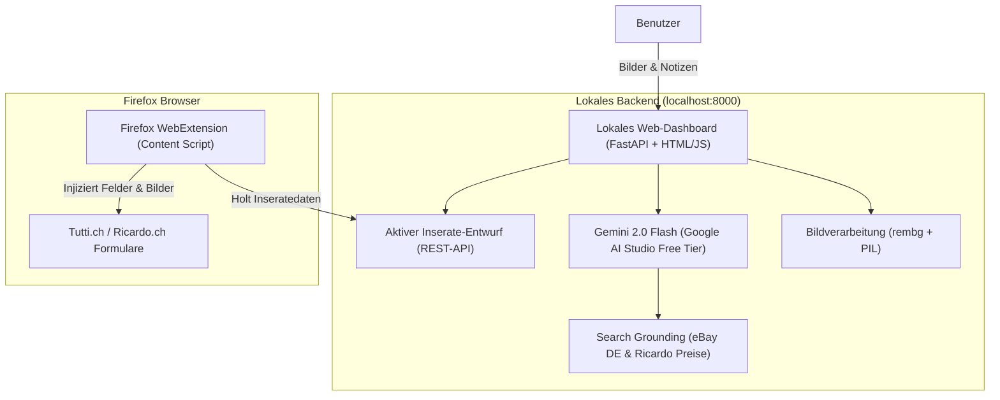

# Anforderungsdokument (Requirements Document)
## KI-gestützter Inserate-Generator für Tutti.ch & Ricardo.ch

* **Projekt:** Tutti & Ricardo Listing Assistant
* **Einsatzbereich:** Persönlicher Gebrauch (Single-User, kein externes Deployment nötig)
* **Status:** Entwurf zur Freigabe
* **Datum:** 2026-10-31

---

## 1. Zielsetzung & Problemstellung

Beim regelmässigen Einstellen von Gebrauchtartikeln auf Schweizer Plattformen (**Tutti.ch** und **Ricardo.ch**) entstehen erhebliche Reibungspunkte:
* Unterschiedliche Plattformanforderungen (Ricardo mit striktem 60-Zeichen-Titel, Auktion vs. Sofortkauf, spezifische Optionen; Tutti als Kleinanzeige).
* Mühsames manuelles Copy-Pasten von Texten, Preisen und Auswählen von Dropdowns.
* Suboptimale Smartphone-Fotos (störende Hintergründe, schlechte Ausleuchtung).
* Schwierige Preisfindung: Wunschpreise auf Tutti/Ricardo reflektieren nicht den tatsächlichen Marktwert.

**Lösung:** Eine lokale Hybrid-Lösung aus einem **FastAPI/Python-Backend mit Web-Dashboard** (für Upload, KI-Bildbearbeitung, Preisfindung und Textgenerierung) und einer **Firefox-Browsererweiterung** zum automatischen Befüllen der Inserate-Formulare (inkl. Bild-Upload) per Klick.

---

## 2. Systemarchitektur & Komponenten

---

## 3. Funktionale Anforderungen (Features)

### 3.1 Eingabe (Input)
* **Bilder-Upload:** Drag & Drop mehrerer Fotos (Smartphone-Fotos, Formate: JPG, PNG, HEIC/WebP).
* **Kurzbeschreibung / Stichworte:** Freitextfeld für grobe Angaben (z.B. *"Sony WH-1000XM4, ca. 2 Jahre alt, wenig gebraucht, OVP & Ladekabel dabei, Polster intakt"*).
* **Optionale Voreinstellungen:**
  * Bevorzugte Verkaufsart bei Ricardo (Auktion vs. Sofortkauf).
  * Standard-Versandoptionen (z.B. Paket B-Post 8.50 CHF, Abholung vor Ort).

### 3.2 Bildanalyse & Optimierung
* **Freistellen (Background Removal):**
  * Lokale Verarbeitung via `rembg` (keine externen API-Token, keine Kosten).
  * Bereitstellung auf neutralem, sauberem Hintergrund (weiss / hellgrau).
  * Beibehaltung der Originalbilder als Alternative (Umschalter im UI).
* **Qualitäts- und Vollständigkeits-Check:**
  * KI prüft, ob wesentliche Merkmale sichtbar sind (z.B. Typenschild, Mängel, Zubehör).
  * Gezielte Hinweise an den Nutzer: *"Bitte fotografiere noch das Typenschild / die Seriennummer für bessere Verkaufschancen"*.
* **Rechtlicher Hinweis (Compliance):**
  * Keine Verwendung fremder Urheberrechts-Bilder aus dem Web als Inseratefoto (Vermeidung von Sperrungen gemäss Ricardo/Tutti AGB). Web-Referenzen dienen ausschliesslich der Modellidentifikation und Spezifikationsabfrage.

### 3.3 Marktrecherche & Preisermittlung
* **eBay Deutschland (Verkaufte Artikel):**
  * Abfrage tatsächlicher Verkaufstransaktionen (eBay Filter: `LH_Sold=1&LH_Complete=1`) via Google Search Grounding.
  * Automatische Umrechnung EUR $\rightarrow$ CHF.
  * Berücksichtigung eines moderaten Schweizer Preisaufschlags (+10 bis +20 % gegenüber deutschem Markt).
* **Ricardo & Tutti Marktpreis-Indikator:**
  * Analyse beendeter Ricardo-Auktionen vs. tutti-Angebotspreise.
* **Preis-Strategie-Ausgabe:**
  * Empfohlener Startpreis für Auktionen (attraktiv für Gebote, kein Ramsch).
  * Empfohlener Sofortkaufen-Preis (realistischer Marktwert).
  * Tutti-Verhandlungsbasis (VHB).
  * Direkter 1-Klick-Link zu beendeten eBay-DE-Angeboten zur manuellen Gegenprüfung.

### 3.4 Textgenerierung & Plattform-Spezifika

#### Ricardo.ch Anforderungen:
* **Titel:** Strikt maximal **60 Zeichen**, suchbegriffsoptimiert (Marke, Modell, Zustand), keine unzulässigen Füllwörter.
* **Untertitel (optional):** Relevante Verkaufsargumente (z.B. "Inkl. Originalverpackung").
* **Beschreibung:** Strukturierter Text (Zustand, Lieferumfang, Spezifikationen, Garantiehinweis gemäss Schweizer Recht *"Privatverkauf, ohne Gewährleistung/Garantie, keine Rücknahme"*).
* **Optionen:** Automatische Vorbelegung von Versandart (Post / Abholung) und Zahlungsmethoden (TWINT, Überweisung, Bar).

#### Tutti.ch Anforderungen:
* **Titel:** Ansprechend und klar verständlich (bis 80 Zeichen).
* **Kategorie-Empfehlung:** Vorschlag der am besten passenden Tutti-Kategorie.
* **Beschreibung:** Fließender, seriöser Verkaufstext inklusive aller relevanten Details.
* **Zustand:** Automatische Klassifizierung (Neu, Wie neu, Gebraucht, Defekt).

### 3.5 Firefox-Erweiterung (Auto-Fill Integration)
* **Technologie:** Firefox WebExtension (Manifest V3 / V2).
* **Bedienung:**
  * Floating Action Button ("Mit KI-Entwurf befüllen") auf der jeweiligen Inserate-Erstellungsseite (`tutti.ch` und `ricardo.ch`).
  * Verbindung zum lokalen REST-Endpunkt (`http://localhost:8000/api/current-listing`).
* **Befüllung der Felder:**
  * Text- & Nummernfelder: Titel, Beschreibung, Preis (mit Auslösung nativer React-Events `input`/`change`).
  * Dropdowns & Checkboxen: Zustand, Garantie, Versandmethoden.
  * **Automatischer Bild-Upload:** Konvertierung der optimierten Bilder via `DataTransfer` und Übergabe an das HTML-`<input type="file">`-Element der Plattform.

---

## 4. Nicht-funktionale Anforderungen

* **Betrieb & Kosten:**
  * 0.- CHF API-Kosten durch Nutzung des kostenlosen Google AI Studio Tiers (Gemini 2.0 Flash mit Search Grounding).
  * Vollständig lokaler Betrieb (kein Cloud-Hosting / Docker-Server im Internet nötig).
* **Datenschutz & Privatsphäre:**
  * Bilder und Entwürfe verbleiben lokal auf dem Rechner.
  * Nur der notwendige Text/Bildinhalt wird zur Analyse an die Google AI Studio API übertragen.
* **Leistung & Geschwindigkeit:**
  * Bildfreistellung via `rembg` < 3 Sekunden pro Bild auf gängiger Hardware.
  * Inseratsgenerierung via Gemini 2.0 Flash < 5 Sekunden.

---

## 5. Phasenplan zur Umsetzung

| Phase | Modul / Schritt | Ergebnis |
| :--- | :--- | :--- |
| **Phase 1** | **Backend & Bildverarbeitung** | FastAPI Backend mit `rembg` & PIL-Bildpipeline |
| **Phase 2** | **KI-Logik & Preisfindung** | Gemini 2.0 Flash Service mit eBay DE & Schweizer Preisrecherche |
| **Phase 3** | **Web-Dashboard UI** | Lokale Weboberfläche für Upload, Vorschau & Anpassung der Inserate |
| **Phase 4** | **Firefox WebExtension** | Add-on mit Content Scripts für Ricardo & Tutti Formular-Befüllung |
| **Phase 5** | **Testing & Feinschliff** | End-to-End-Test mit realen Inserat-Beispielen |
